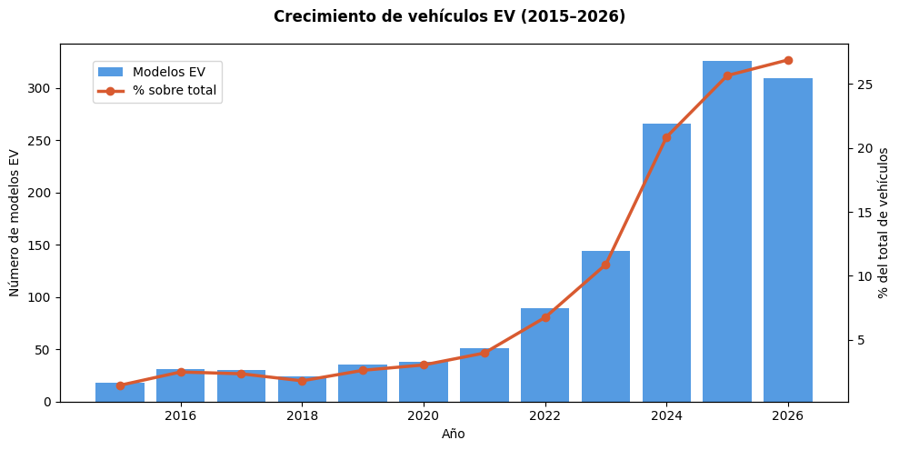
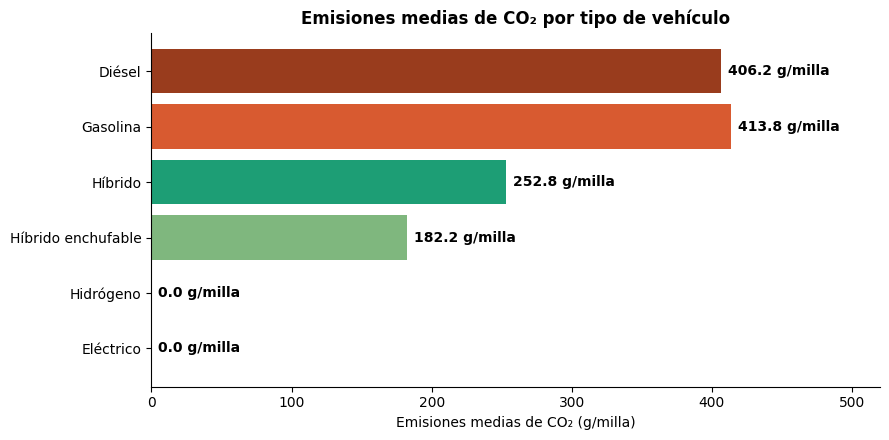
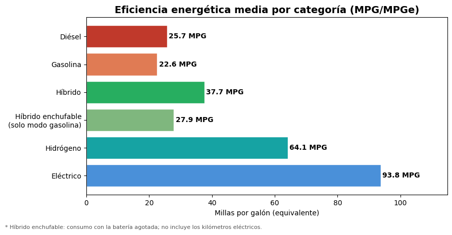
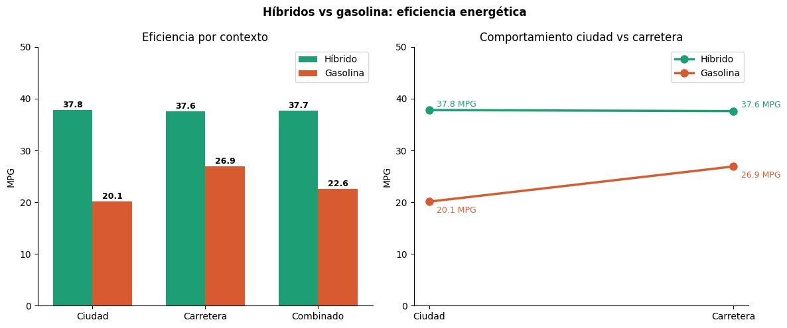
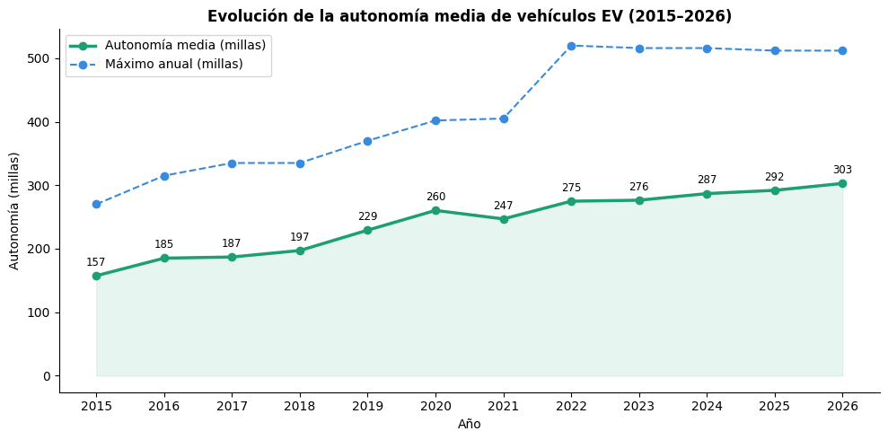

# Vehículos eléctricos frente a combustión: análisis de datos de la EPA (2015–2026)


**Pregunta:** ¿cómo han evolucionado los vehículos eléctricos frente a los híbridos y los de combustión en número de modelos, emisiones, eficiencia y autonomía?

**En resumen:**
- Los modelos eléctricos homologados pasaron de 18 en 2015 a 326 en 2025 (**+1.711 %**).
- Su autonomía media subió de 157 a 292 millas (de 253 a 470 km), un **+85,5 %**.
- Son **4,2 veces más eficientes** que los de gasolina, y los híbridos un **67 % más**.
- Kruskal-Wallis y Mann-Whitney U con corrección de Bonferroni confirman diferencias significativas en emisiones y eficiencia en **15 de 16 comparaciones**.

---

## Datos

- **Fuente original:** [fueleconomy.gov](https://fueleconomy.gov/) (U.S. Department of Energy / EPA)
- **Descarga:** [Kaggle](https://www.kaggle.com/datasets/iconicwasil/vehicle-specs-and-carbon-footprint-2015-2026), dataset obtenido por su autor mediante web scraping de fueleconomy.gov
- **Tamaño:** 15.301 modelos y 14 variables (fabricante, año, tipo de combustible, consumo en ciudad, carretera y combinado, emisiones de CO₂, autonomía eléctrica, entre otras)

### Corrección de categorías

Al cruzar la categoría del vehículo con el tipo de combustible detecté que la categoría original **"Hybrid/Other" no contenía híbridos**: sus 41 vehículos son de **hidrógeno** (Toyota Mirai, Hyundai Nexo…). Los híbridos reales estaban incluidos dentro de la gasolina.

Para analizarlos bien creé una nueva variable `Categoria`:

| Categoría | Criterio | Modelos |
|---|---|---|
| Gasolina | Resto de vehículos de gasolina | 12.676 |
| Eléctrico | Categoría original EV | 1.361 |
| Híbrido | Gasolina sin autonomía eléctrica y con "Hybrid", "Prius", "Insight" o "450h" en el modelo | 489 |
| Híbrido enchufable | Gasolina con autonomía eléctrica | 424 |
| Diésel | Categoría original | 308 |
| Hidrógeno | Antigua categoría "Hybrid/Other" | 41 |
| Gas natural | Categoría original | 1 |

## Hipótesis

1. El número de modelos eléctricos ha crecido de forma clara entre 2015 y 2025.
2. Los eléctricos emiten menos CO₂ en el punto de uso que los de combustión.
3. La autonomía de los eléctricos ha mejorado en los últimos años.
4. Los híbridos son más eficientes que los vehículos de gasolina.
5. El tipo de vehículo influye en las emisiones y en la eficiencia energética.

## Principales conclusiones

- **Crecimiento:** los modelos eléctricos homologados crecieron un **+1.711 %** entre 2015 y 2025, de 18 modelos (1,45 % del total homologado) a 326 (25,65 %). El despegue empieza en 2022.
- **Emisiones:** los eléctricos emiten **0 g de CO₂ por milla** en el punto de uso, frente a **413,8 g** de la gasolina y **406,2 g** del diésel. Los híbridos emiten 252,8 g (un 39 % menos que la gasolina) y los híbridos enchufables 182,2 g (un 56 % menos).
- **Autonomía:** la autonomía media de los eléctricos pasó de **157,4 millas (253 km)** en 2015 a **292 millas (470 km)** en 2025, un **+85,5 %**. El récord es del **Lucid Air**, con 520 millas (837 km).
- **Eficiencia de los eléctricos:** **4,2 veces más** que la gasolina (93,8 MPGe frente a 22,6 MPG).
- **Híbridos enchufables:** su MPG en el dataset (27,9) es el del modo gasolina, con la batería agotada, por eso sale por debajo del híbrido. Lo comprobé con el CO₂: a 27,9 MPG les corresponderían 349 g/milla, pero registran 182,2 porque su CO₂ sí incluye los kilómetros eléctricos. Por eso no los comparo en eficiencia.
- **Híbridos:** un **67 % más eficientes** que la gasolina (37,7 frente a 22,6 MPG). Apenas pierden eficiencia en ciudad (37,8 frente a 37,6 MPG en carretera), mientras que la gasolina cae de 26,9 a 20,1 MPG, algo que encaja con el frenado regenerativo.
- **Fabricantes:** **Tesla** lidera con 177 versiones eléctricas homologadas, seguida de Rivian (161) y BMW (131). **39 fabricantes** tienen al menos una, y el 67,4 % se concentra en los 10 primeros.
- **Contraste estadístico:** Kruskal-Wallis confirma diferencias entre categorías en emisiones y eficiencia (p < 0,001). Con Mann-Whitney U por parejas y corrección de Bonferroni, 15 de 16 comparaciones son significativas. La única excepción: **gasolina y diésel emiten prácticamente lo mismo** (p = 0,69).

## Visualizaciones

### Crecimiento de modelos eléctricos (2015–2026)


### Emisiones medias de CO₂ por tipo de vehículo


### Eficiencia energética por tipo de vehículo


### Híbridos frente a gasolina: ciudad y carretera


### Evolución de la autonomía media de los eléctricos


## Limitaciones

- El dataset recoge modelos homologados por la EPA, no unidades vendidas: los porcentajes no son cuota de mercado.
- Los modelos de 2025–2026 están homologados, pero pueden no estar todavía a la venta.
- Las emisiones de los eléctricos son 0 en el punto de uso, no en todo su ciclo de vida: dependen del mix energético con el que se cargan.
- Los híbridos se identifican por el nombre del modelo, así que puede haber alguno sin detectar.
- En los híbridos enchufables, el MPG es el del modo gasolina, así que no se comparan en eficiencia con el resto.
- Los grupos de hidrógeno (41) y gas natural (1) son demasiado pequeños para el contraste estadístico.
- Los datos corresponden al mercado de EE. UU.

## Tecnologías

Python, Pandas, NumPy, Matplotlib, Seaborn, SciPy y Jupyter Notebook.

## Estructura del repositorio

    EDA_Vehiculos_Electricos_vs_Combustion/
    ├── README.md
    ├── requirements.txt
    ├── main.ipynb                     # Análisis completo
    ├── Memoria.pdf
    ├── Presentacion.pdf
    └── src/
        ├── data/coches.csv            # Dataset
        ├── img/                       # Gráficos generados por el notebook
        ├── notebooks/
        │   └── exploracion_inicial.ipynb
        └── utils/funciones.py         # Funciones auxiliares (outliers, gráficos, tests)

## Cómo reproducirlo

```bash
git clone https://github.com/terelopdel-sketch/EDA_Vehiculos_Electricos_vs_Combustion
cd EDA_Vehiculos_Electricos_vs_Combustion
pip install -r requirements.txt
jupyter notebook main.ipynb
```

## Autora

**María Teresa López Delgado**
- [GitHub](https://github.com/terelopdel-sketch)
- [LinkedIn](https://linkedin.com/in/mariateresa-lopez-delgado)
